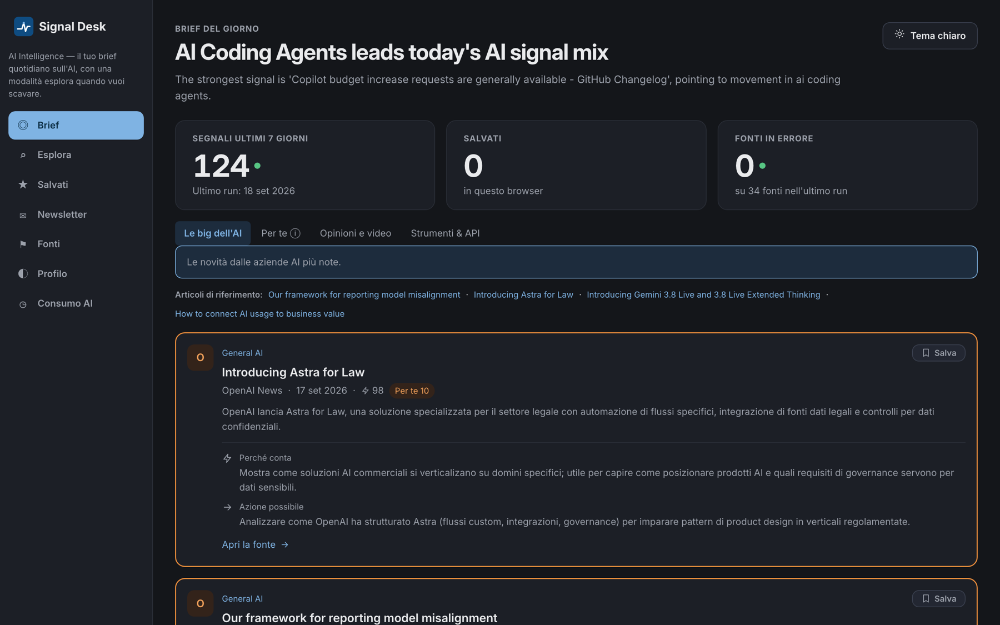
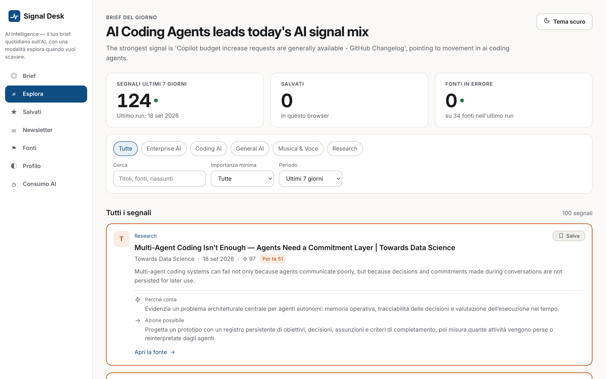
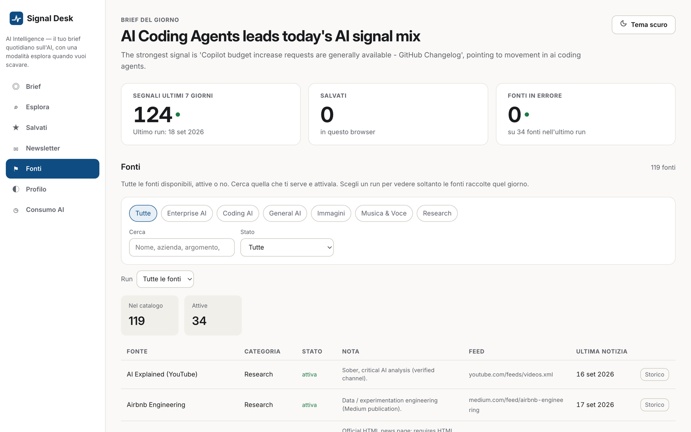

<div align="center">
  

  # Signal Desk

  **Your daily AI briefing. Ten minutes, not two hours.**

  Runs on your own computer. No account, no subscription, no data leaving your machine.

  🇬🇧 English · [🇮🇹 Italiano](README.it.md)
</div>

<p align="center">
  
</p>

---

## The problem

AI news breaks every day across dozens of sources: lab blogs, model releases, new
tools, open-source projects. Following all of them is impossible. Ignoring them means
falling behind.

## The solution

Signal Desk collects the news from official sources every day, filters out the noise,
ranks what's left by importance, and hands you a **briefing you can read in a few
minutes**, each item with *why it matters* and *what you can do about it*.

Write a couple of lines about yourself (what you do, what you want to learn) and the
briefing adapts to your interests.

---

## What's inside

| | |
|---|---|
| 📰 **Brief** | What matters today, already summarized and ranked by relevance. |
| 🔍 **Explore** | Every signal collected, filterable by topic, source, quality and date. |
| ⭐ **Saved** | Set articles aside to come back to them later. |
| ✉️ **Newsletter** | Generate a custom edition for any period you pick (a week, a month…). |
| 🔬 **Deep dive** | One click on an article and the AI explains it in more depth. |
| ✍️ **No filler** | When the AI has not analysed an article yet, the app says so and offers to analyse that one article, instead of printing one generic sentence for everything. |
| 👤 **Profile** | Describe yourself and get a "For you" section tuned to your interests. |
| ⚑ **Sources** | A curated set of official sources active from day one, out of a larger catalogue. Add or drop any of them. |
| ◷ **AI usage** | How much AI you're using, run by run. Full transparency, no surprises. |
| 🌗 **Light/dark theme** | Plus an interface in English or Italian, your choice. |

<p align="center">
  
  
</p>
<p align="center"><sub>Explore and Sources, in light theme.</sub></p>

**It works without AI too.** Every feature has an automatic fallback: with no AI tool
connected, the app still collects, filters and ranks everything. AI adds the
well-written summaries, the deep dives and the personalization.

---

## Installation

All you need is **Python** on your computer. If you don't have it, the scripts say so
and give you the link: it takes two minutes from
[python.org](https://www.python.org/downloads/).

### 🍎 On Mac

1. Download the project ([Code → Download ZIP](https://github.com/Manfrini/signal-desk)) and open it.
2. Go into the `scripts` folder and **double-click `start.command`**.
3. Wait: the first run sets everything up on its own. Then Signal Desk opens in your browser.

> If macOS says the script is from an unidentified developer: right-click the file →
> **Open** → **Open**. Only happens the first time.

### 🪟 On Windows

1. Download the project ([Code → Download ZIP](https://github.com/Manfrini/signal-desk)) and open it.
2. Go into the `scripts` folder, right-click **`start.ps1`** → **Run with PowerShell**.
3. Wait: the first run sets everything up on its own. Then Signal Desk opens in your browser.

> If Windows blocks the script, open PowerShell in the project folder and paste:
> ```powershell
> powershell -ExecutionPolicy Bypass -File scripts/start.ps1
> ```

### Then what?

Every day after that: the same double-click. That's it.

---

## First run: 2 minutes

The first time you open it, a short wizard asks three things:

1. **Which language** you want for the app and for the content.
2. **Who you are**, in a few free-form lines: this is what personalizes the briefing. Skippable.
3. Whether to **run a first collection** right away, so you have something to read.

You can decline every step and change it later from the **Profile** section.

## Want AI-written summaries too?

Optional, but it's where Signal Desk is at its best. You need one of these tools (free
to install; to use it you sign in with a Claude or ChatGPT subscription):

- [Claude Code](https://claude.com/claude-code): `npm install -g @anthropic-ai/claude-code`
- Codex CLI: `npm install -g @openai/codex`

Then go to **Profile → AI settings**, pick which one to use, and sign in straight from
the app. Usage stays visible in the **AI usage** section.

> **One difference worth knowing.** With **Codex**, the AI can run read-only
> commands on your computer: that is how that tool works, and it cannot be
> turned off. In theory a malicious article, among the ones collected, could
> talk the AI into reading a file of yours and showing its contents in the app.
> With **Claude** this does not happen: file reading is refused, and we checked.
>
> In practice the risk is low (the sources are official blogs you pick
> yourself), and Signal Desk always fences third-party text before handing it
> to the AI. But if you want the tightest isolation, use Claude; either way,
> only add sources you trust.

---

## Quick questions

**Does my data leave my computer?**
No. Everything (articles, profile, preferences) stays local. The only connections are
to the news sites and, if you enable it, to your AI tool. The dashboard answers
only your own computer and refuses requests coming from other sites. Do read the
note above on the difference between Codex and Claude, though.

**Does it cost anything?**
The app doesn't, it's open source. If you connect an AI, your plan with that service
applies, and you can see the usage inside the app.

**Do I need to know how to code?**
No. Double-click the script and the app opens in your browser like any website.

**Something already uses port 8000 on my machine.**
Not a problem: Signal Desk notices and moves to the first free port (8001,
8002…), saying so as it starts. The browser opens on the right one by itself.

**Can I choose the sources?**
Yes, from the **Sources** section: add, edit or disable whatever you want, without
touching a file.

---

## For developers

Terminal commands, architecture, data formats, design system, advanced configuration
and development workflow: **[docs/TECHNICAL.md](docs/TECHNICAL.md)**.
Security review, threat model and known limitations:
**[docs/SECURITY-REVIEW.md](docs/SECURITY-REVIEW.md)**.

In short:

```bash
python -m pip install -r requirements.txt
python -m src.main setup      # guided setup
python -m src.main run-daily  # full pipeline
python -m src.main serve      # dashboard at http://127.0.0.1:8000
```

## License

See [LICENSE](LICENSE).
